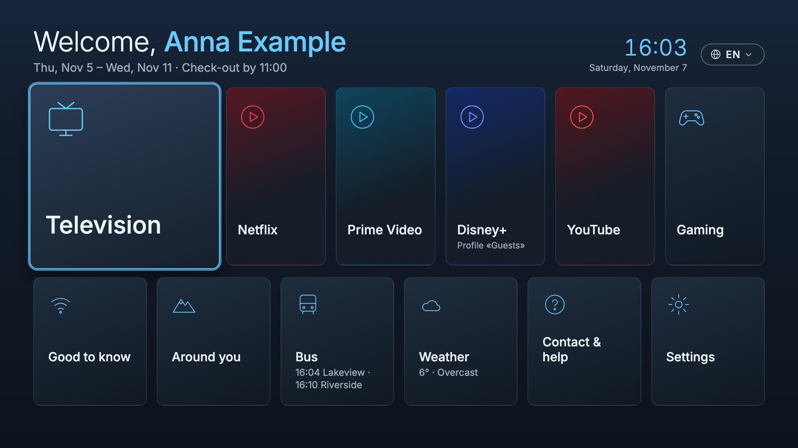
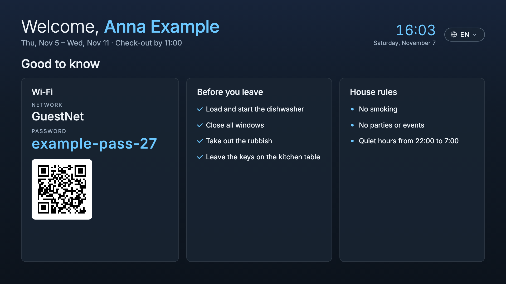
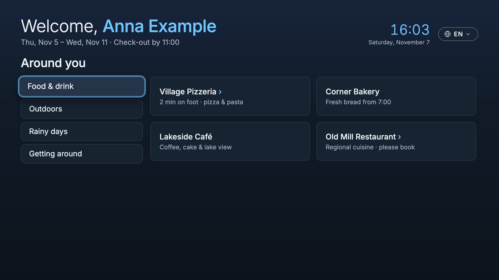
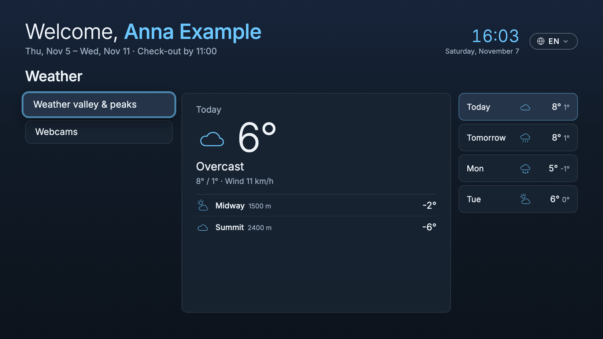
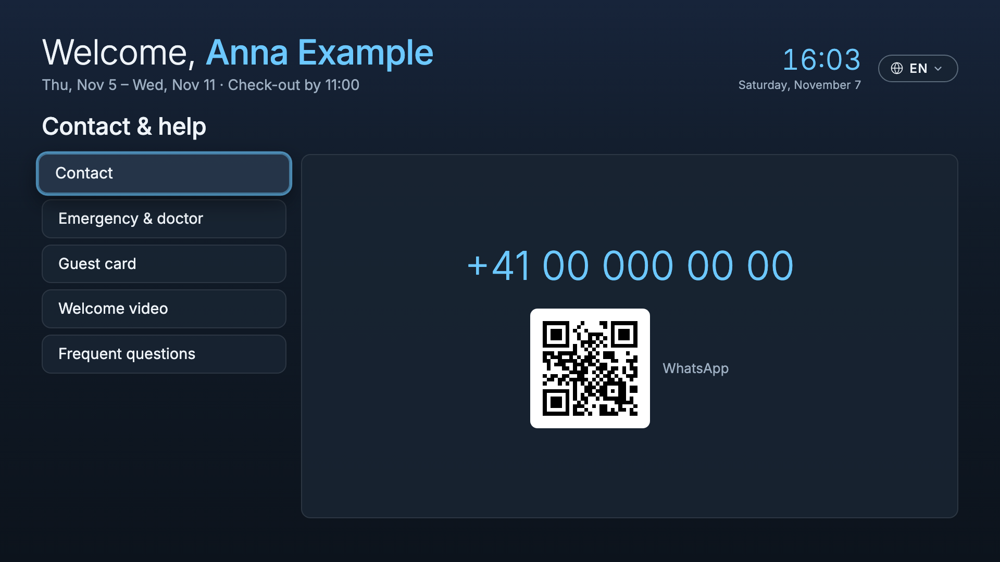
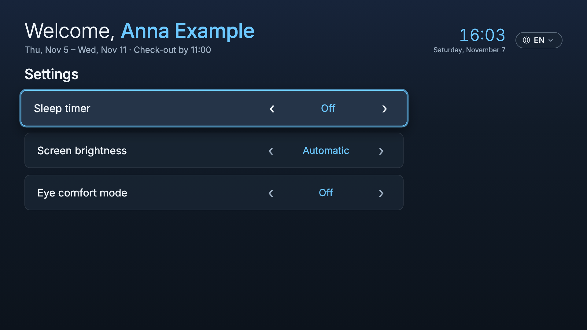
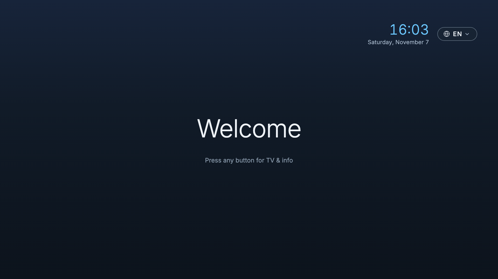

# guest-tv

guest-tv is a free, open-source template for a hotel-style home screen on rooted LG webOS TVs in a holiday rental. A Raspberry Pi greets each guest on the TV and resets the TVs after every stay. It runs in my holiday apartment in the Swiss Alps, which has three LG TVs. I wanted a start screen like in a hotel without extra hardware. The alternative was three Google TV boxes plus kiosk-app licenses.

The screenshots show invented places, numbers and names.



*Home screen: greeting, stay dates, clock, two rows of tiles.*



*Good to know: Wi-Fi with QR code, check-out list, house rules.*



*Around you: local tips, here the category "Food & drink".*



*Weather: today, the next days, valley and two mountain points.*



*Contact and help: placeholder number and WhatsApp QR code.*



*Settings: sleep timer, brightness, eye comfort mode.*



*Vacancy screen, shown when no guest is booked.*

## How it works

### The TV app

A plain web app (HTML, CSS and JavaScript, no framework), installed on each TV as a developer app. It has to run on old TV browsers: webOS 4 has Chromium 53 and webOS 5 has Chromium 68, so the CSS avoids grid and other newer features. The layout is fixed at 1920x1080, which is what web apps get even on a 4K TV.

### The Raspberry Pi

The Pi sits in the same network as the TVs and runs Python with only the standard library plus the `qrencode` package. Every hour it builds one state file: the current guest from [Smoobu](https://www.smoobu.com/) or a JSON file, weather from [Open-Meteo](https://open-meteo.com/), bus departures from [transport.opendata.ch](https://transport.opendata.ch/) (Switzerland only), webcam images, local content, and the guest Wi-Fi with QR codes. `serve.py` serves it on port 8090. Images come from the Pi, never directly from the internet.

### How they talk

The TVs fetch the state file every 5 minutes. LG does not let third-party apps change TV settings: the settings service answers "Access denied" except for a short read-only allow list. So the app sends the guest's choice to the Pi, and the Pi writes the setting on the TV as root over SSH. The Pi accepts these requests only from the configured TV addresses and only with the app's origin. It allows only fixed actions with fixed values, and no text from a request ever reaches a shell.

An LG TV returns to its last input when it is switched on, even with LG's own "launch Home on start" option. So a small script on the TV watches the power state and brings the app to the front whenever the TV wakes from standby.

### Offline

The app keeps the last state and ships with its content, so it starts and works without the Pi. It shows an Offline badge. Live values older than 3 hours are hidden.

### After every stay

After each departure the Pi resets every TV between 11:00 (check-out) and 16:00 (check-in), only while no guest is in the apartment. Before 15:00 it touches only a TV that is switched off; from 15:00 it resets a running TV too. Per TV it wakes the TV with Wake-on-LAN, closes the media apps, restores the recorded normal picture and sound, switches the sleep timer off, sets the original system language back, deletes the Netflix, YouTube and Prime Video login data from a fixed list of files, checks that it is gone, reboots, waits for the Homebrew startup and switches the TV off.

Disney+ and the live TV app stay logged in, because they are the host's accounts. Netflix, YouTube and Prime Video get logged out because guests may have used their own accounts. If a step fails, the Pi switches the TV off again and tries again the next hour. The window is checked again before each TV, so no reset starts after 16:00 even if a run began just before. A stay extended after its cleanup gets its own cleanup at the new departure, and departures of the last 7 days that the Pi missed while switched off are cleaned up when it is back. A booking cancelled after the stay still gets its cleanup at its departure date, because the stay may have been real. The owner's blocked dates never get one. In my final tests on 3 November 2026 a full reset took about two to three minutes per TV, and the reboot took 54 seconds on the OLED.

## What it does

- Greets each guest by name, with the stay dates, in the guest's language. On the departure day a check-out banner opens the check-out list until 11:00. From 11:00 the TV shows the vacancy screen, or the next guest's greeting on an arrival day.
- Six languages: German, English, French, Italian, Dutch, Polish. The language comes from the booking and the guest can switch it. The TV's own system language follows.
- Two rows of tiles. First: TV (the live TV app), Netflix, Prime Video, Disney+, YouTube and Gaming for consoles on HDMI. Second: Good to know, Around you, Bus, Weather, Contact and help, Settings.
- Guests can set a sleep timer (off, 30, 60, 90, 120 minutes), screen brightness (automatic, bright, medium, dimmed, dark) and eye comfort mode.
- After 3 minutes without input a screensaver shows clock, date and weather. The clock moves every minute so nothing burns into an OLED panel.
- Works with the LG remote's arrow keys and the Magic Remote pointer.
- Shows only information that is always true: no taglines, no help texts, nothing seasonal, no opening hours that may change.
- Resets every TV after each stay.

## What you need

- A rooted LG webOS TV. The Pi changes TV settings as root over SSH. My three TVs ran firmware that LG no longer updates, and a public exploit could root it. After an LG update, rooting might no longer be possible, so it is a now-or-never decision for each TV, and the TV then stays on that firmware. After rooting, put the Pi's public SSH key on the TV, turn SSH on and telnet off, and switch off automatic updates.
- A Raspberry Pi in the same network as the TVs, and a separate guest Wi-Fi for your guests.
- For each TV: a fixed IP address in the router, its Wi-Fi MAC address, Quick Start+ on and Wake-on-LAN over Wi-Fi on.
- A booking system. Smoobu is the example, a JSON file in the same shape works too.
- A development machine (macOS or Linux) for the package build and the tests, and a coding agent that can follow AGENTS.md.

## Build it with your agent

The repo carries `AGENTS.md`, a build guide your coding agent follows. The file also holds the webOS findings I measured on the TVs.

The agent asks you first, and you answer: which TVs (models, webOS versions, IP and Wi-Fi MAC addresses), the Pi's address and user, your booking system, check-out and check-in times, languages, the property name, guest Wi-Fi, location for weather, mountain points, bus stop, webcams, local tips, emergency numbers, contact details, the live TV and streaming apps, which accounts stay logged in, and whether the after-departure reset should run.

Rooting stays your job: use the methods of the [webOS Homebrew project](https://www.webosbrew.org/), only on TVs whose firmware it lists.

Everything specific to your place sits in one config file. In your copy of the repo, copy `pi/config.example.json` to `pi/config.json` (git ignores it) and fill it in; `pi/config.py` explains every field. Then copy the `pi/` folder to the Pi, and `bootstrap.sh` installs the file as `~/guest-tv/config.json` when there is none yet. The app ID `com.example.guesttv` appears in several files and the self check fails if they differ, so rename it in all of them. Before the reset runs for real, record each TV's normal state once, do a dry run, do one supervised real run, then switch `turnover` on in the config.

## Run the tests

The browser walkthrough runs 230 checks in headless Chromium at 1920x1080: remote control by keyboard, the Magic Remote pointer, all six languages with no text cut off, the settings flow, the check-out banner, the vacancy screen, the screensaver and the real request path to the Pi. The Pi tests run offline on invented bookings, without SSH or network: guest phases around check-out and check-in including summer time, the state file, the settings whitelist, the delete list (run for real in a test folder), the wake packet and the whole reset against a simulated TV. Offline tests for the TV scripts use stand-ins for the TV's tools: the install result, the way back out of hotel mode and SSH only with the Pi's key. A self check covers the language files, the content, the app ID and the Back key setting. The Pi tests also pass on Python 3.11, the version on Raspberry Pi OS.

```
git clone https://github.com/kevintheo-ai/guest-tv && cd guest-tv
node test/selfcheck.mjs
python3 test/test_state_builder.py
python3 test/test_tv_settings.py
python3 test/test_turnover.py
python3 test/test_scripts.py
pip install playwright==1.58.0
python3 -m playwright install chromium
python3 test/ui_walkthrough.py
```

## Safety

- The TVs are rooted and can be controlled over the network. Keep the TVs and the Pi in a network guests cannot reach, and give guests a separate guest Wi-Fi. That also protects the state file: it contains the guest's name, the stay dates and the guest Wi-Fi password, and any device in the same network could read it.
- Allow root access only over SSH with the Pi's key, and switch telnet off in the Homebrew Channel.
- Rooted TVs stay on firmware that LG no longer patches. Turn off automatic updates; the Homebrew Channel can block LG's update servers. This is a known, accepted risk.
- Rooting is done by the owner, only on TVs whose firmware the webOS Homebrew project lists. The repo contains no rooting tool.
- The reset deletes only files on a fixed list and checks afterwards. Anything else stays. If any folder on a delete path is a symlink, the reset stops (exit 5), so an app cannot redirect a delete outside its own folder. If a guest logs out of Disney+ or the live TV app, or logs in there with an own account, the reset does not undo it. Picture values on HDMI inputs stay as the guest set them.
- Open-Meteo's free API is for non-commercial use under its terms, so a rental may need their paid plan. Webcam images and resort pages belong to their owners, so ask before you show them.
- If your TVs are rooted, publish nothing that identifies your apartment.

## Known limits

- It needs a rooted TV on firmware the webOS Homebrew project lists. I tested webOS 4.10 (2019 LCD TVs) and webOS 5.6 (2020 OLED) on three TVs in one apartment and have no results from other models.
- Bus departures work for Switzerland only.
- Check-out (11:00) and check-in (16:00) are constants in `pi/state_builder.py`, `pi/turnover.py` and `app/js/app.js`, plus the texts in `app/i18n/`.
- The settings (gear) key stays open. None of LG's hotel-mode switches locks only that key, and the ones that lock it also lock the Home key. LG's hotel mode locks the voice key; the Home key opens the app.
- On the OLED, LG's own screensaver can start after a few minutes without input.
- With Quick Start+ off the TV goes into deep sleep, every power-on is a cold boot, and waking over the network may fail.
- If a TV is switched off while the Homebrew startup is still running, it may boot into "Failsafe mode" without root. On the TV, choose "Reboot now".

## Credits and license

MIT License, Copyright Kevin Theobald. The Inter font is under the SIL Open Font License, LG's webOSTV.js library under Apache 2.0, and everything else under MIT.

I decided the approach and what goes on the screen, and I tested every version on the TVs in the apartment. Claude Code wrote the code from my plan. Models from other labs reviewed it: OpenAI's Codex, Z.ai's GLM, Meta's Muse and xAI's Grok, in six review rounds over three days. Every finding was checked against the code before anything was fixed.

The public version had its own review round on 7 November 2026 with the same four models. The real findings were fixed, each with a test that failed before the fix.

Project page: https://kevintheo.com/guest-tv/ and more tools at https://kevintheo.com/tools/
